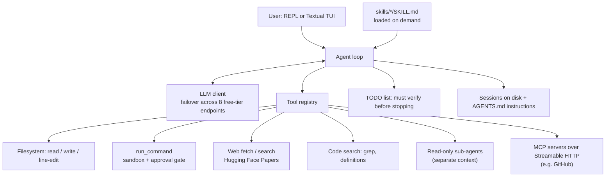

# Code Scout: An Autonomous Coding Agent, Built From Scratch

**Aman Dangar · IIT Delhi · CAIC Summer of Technology 2026, GenAI track**

Code Scout is a terminal coding agent that reads a codebase, runs commands, edits files and checks its
own work. I built every layer myself over five weeks, starting from a raw LLM API call and without an
agent framework, to understand where agents actually fail: losing context, acting unsafely, stopping
before the work is verified, and breaking when an API goes down.

## Architecture



## Design decisions and why

| Problem agents have | What I built |
|---|---|
| **They stop before the job is done** | A persistent TODO list the agent must clear, including a verification step (run the tests or re-run the failing command), before it may finish. |
| **They do dangerous things** | `run_command` runs read-only commands directly but pauses anything destructive or modifying for explicit user approval. |
| **Context fills up with exploration** | Research goes to **read-only sub-agents** with their own context window, and only their summary returns to the main agent. |
| **Every new procedure needs new code** | A **skills system**: dropping a `SKILL.md` into `skills/` teaches a procedure, loaded only when relevant (progressive disclosure). |
| **Tools are hard-coded** | **Model Context Protocol** client over Streamable HTTP: external servers' tools merge into the registry at runtime, configured in `config.json`. |
| **Free-tier APIs rate-limit mid-task** | Automatic failover across **8 free-tier LLM API endpoints** on HTTP 429, without losing the conversation. |
| **Work is lost between runs** | Sessions saved and resumed from disk, with standing instructions in `AGENTS.md`. |

## What I learned

- The hard part of an agent is not calling tools but **deciding when it is done**. Explicit verification
  changed behaviour more than prompt wording.
- **Context is a budget.** Sub-agents and on-demand skills are both ways of spending it carefully.
- Safety has to live in the tool layer, not in the prompt.

## Next steps

- An evaluation setup: a fixed set of bug-fix tasks with pass/fail tests, to measure success rate,
  steps and tokens per task, and compare design choices (with vs without sub-agents, with vs without the
  verification TODO).

## The 5-Week Evolution (Directory Structure)

This repository is organized by week, demonstrating the architectural evolution of the agent. You can explore each folder to see how the complexity scaled.

### [Week 1: The Foundation](week_1/)
We started with the absolute basics. I implemented secure API-key hygiene using `.env`, mastered LLM API mechanics, and built a manual conversation state manager to hold coherent multi-turn conversations without any external frameworks.

### [Week 2: Tools & Terminal UI](week_2/)
I built a custom tool-calling schema from scratch before transitioning to native function calling. The agent gained the ability to fetch web pages, search the web, and connect to its first basic MCP server to read academic papers. Everything was wrapped in a beautiful full-screen Terminal UI (TUI).

### [Week 3: Memory & Filesystem](week_3/)
An agent needs persistence. I added the ability to save/resume sessions to disk and implemented persistent instructions via `AGENTS.md`. More importantly, the agent gained hands: it can now read files, write code, and edit existing files using a precise line-replacement tool.

### [Week 4: Code Scout - The Coding Agent](week_4/)
This is where it became a real coding assistant. I implemented `run_command` with a safety sandbox, allowing the agent to run tests and analyze crashes. I built a persistent `TODO` system to force the agent to verify its changes before stopping. It also gained codebase exploration tools (grep, definitions) and the ability to spin up read-only subagents for research without polluting its main context window.

### [Week 5: The Extensible Platform](week_5/)
The final capstone. Code Scout transformed from a hardcoded script into an extensible platform:
- **Skills System**: By dropping a `SKILL.md` into the `skills/` directory, the agent can learn any new procedure.
- **Configuration as Code**: Hardcoded API endpoints were replaced with a dynamic `config.json`.
- **Dynamic MCP Integration**: Using Streamable HTTP, the agent can connect to external servers (like GitHub) on the fly, seamlessly merging their tools into its own capabilities.

---

## Running the Final Version (Week 5)

Want to try out the final, fully-featured version of Code Scout?

### 1. Setup
```bash
# Navigate to the final project directory
cd week_5/project

# Create a virtual environment and install dependencies
python -m venv venv
source venv/bin/activate
pip install -r requirements.txt
```

### 2. Configuration
Copy the `.env.example` file to `.env` and add your API keys:
```bash
cp .env.example .env
```
*(You will need at least one Gemini, Groq, or OpenRouter API key).*

### 3. Run the Agent
Start the interactive REPL:
```bash
python agent.py
```
Or start the full-screen TUI:
```bash
python agent.py --tui
```

### 4. Try the Features!
- Type `/skills list` to see what the agent can do automatically (try asking it to "commit my changes").
- Type `/mcp list` to view available external servers.
- Ask it to fix a bug in your code, and watch it explore, edit, and verify!

---
*Built with ❤️ during CAIC SOT 2026. No LangChain or high-level frameworks were used in the making of this agent.*